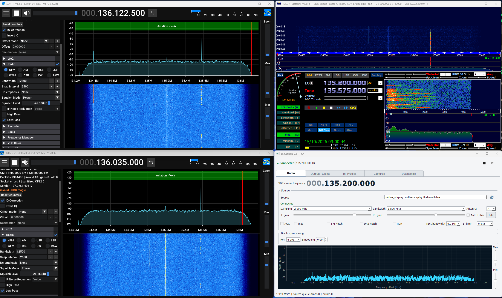

# SDRbridge

SDRbridge est un répartiteur RX pour Windows : il ouvre une seule source SDR, publie son flux IQ et permet à plusieurs applications de réception de l’utiliser simultanément sans leur donner le contrôle du matériel.

Le projet prend actuellement en charge une source simulée, le replay SigMF et le backend natif SDRplay/RSPdx. Un backend générique SoapySDR est implémenté pour étendre la compatibilité à d’autres récepteurs, mais sa couche d’exécution n’est pas encore intégrée au paquet Windows ni qualifiée avec chaque matériel.



*Trois clients connectés au même bridge : deux instances SDR++ via SDBU v2 et HDSDR via ExtIO. SDRbridge reste l’unique autorité sur la fréquence centrale et les réglages du récepteur.*

## Ce que fait le projet

- acquisition RX depuis une source unique : SDRplay natif, SoapySDR, simulation ou replay SigMF ;
- distribution locale multiprocessus par ring partagé SDBR v2 ;
- transport UDP SDBU v2 avec métadonnées de fréquence, taux, format, séquence et époque ;
- profils DSP partagés `CS16`/`CF32`, notamment 2 MS/s, 192 kS/s et 96 kS/s ;
- interface Qt pour la radio, les sorties, les profils RF, les captures et les diagnostics ;
- connecteur natif SDR++ x64, ExtIO HDSDR Win32 et shim ANTRACK ;
- capture et replay SigMF 1.2.6 ;
- fonctionnement strictement RX : aucun chemin TX n’est activé.

```text
SDR / simulation / replay
          |
      SDRbridge
       /  |  \
 SDBU v2 SDBR v2  capture SigMF
    |       |
  SDR++   HDSDR / ANTRACK
```

Les applications clientes sont en lecture seule. Changer une fréquence dans SDR++ ou HDSDR ne reconfigure pas le RSPdx : la valeur effective du bridge est réappliquée au client.

## Compatibilité avec les récepteurs SDR

| Récepteur | Chemin prévu | État vérifié |
|---|---|---|
| SDRplay RSPdx | backend natif SDRplay | flux réel observé |
| Autres modèles SDRplay | backend natif ou SoapySDR selon le modèle | à qualifier matériellement |
| RTL2832 / RTL-SDR | backend SoapySDR avec `SoapyRTLSDR` | implémenté dans le code, non testé avec une clé réelle |
| Airspy, HackRF, LimeSDR, UHD, etc. | module SoapySDR correspondant | compatibilité potentielle, non qualifiée |

Une clé RTL2832 n’est donc **pas encore plug-and-play avec le `Setup.exe` actuel**. Elle nécessite au minimum le pilote WinUSB adapté, un runtime SoapySDR x64 avec le module `SoapyRTLSDR`, puis une distribution SDRbridge reconstruite avec la couche Python Soapy compatible. Le lancement se fait alors avec `--source soapy` et le périphérique doit apparaître dans la liste de la page **Radio**.

Sur la machine de développement, PothosSDR expose bien la factory `rtlsdr`, mais aucune clé RTL2832 n’était connectée pendant cette vérification. Cette présence logicielle ne constitue pas une preuve de réception matérielle.

## Installer SDRbridge

### Installation simple pour un utilisateur final

Le fichier à distribuer est **`SDRbridge_Setup_0.3.0.exe`**. Il contient l’application et ses dépendances intégrées : l’utilisateur le lance, suit l’assistant, puis démarre SDRbridge depuis le menu Démarrer ou le raccourci du Bureau. Il n’a besoin ni de Python, ni de Git, ni de Visual Studio. Les pilotes matériels et le runtime SoapySDR générique restent des prérequis externes lorsqu’ils sont utilisés.

**`SDR_Bridge.exe` ne doit pas être copié seul.** Le build actuel est une application portable « en dossier » : l’exécutable dépend des DLL et du répertoire `_internal` placés à côté de lui. Deux distributions sont donc possibles :

- recommandée : le fichier unique `SDRbridge_Setup_0.3.0.exe` ;
- portable : une archive ZIP contenant le dossier `SDR_Bridge` complet, à extraire sans déplacer l’exécutable hors de ce dossier.

Pour utiliser un RSPdx, le pilote et l’API SDRplay officiels doivent aussi être installés sur le PC. Ils ne sont pas remplacés par SDRbridge. Les connecteurs SDR++ et HDSDR s’installent ensuite avec les procédures dédiées plus bas.

> Le dépôt Git versionne actuellement les sources et les DLL clientes, pas le paquet principal généré `release-v0.3`. Aucune release binaire n’est encore publiée sur GitHub : le mainteneur doit construire puis joindre le `Setup.exe` à une release avant de diriger les utilisateurs non techniques vers la page Releases.

### Construire la distribution depuis les sources

#### 1. Installer les prérequis

- Windows 10 ou 11 x64 ;
- Git ;
- Python 3.12 x64 ;
- Visual Studio Build Tools avec **Développement Desktop en C++** et CMake ;
- l’[API SDRplay](https://www.sdrplay.com/api/) si le RSPdx ou le backend natif SDRplay doit être utilisé ;
- Inno Setup 6, facultatif, uniquement pour produire un assistant `Setup.exe`.

#### 2. Cloner et préparer l’environnement

```powershell
git clone https://github.com/stephanerey/SDRbridge.git
cd SDRbridge
py -3.12 -m venv .venv
.\.venv\Scripts\python.exe -m pip install --upgrade pip
.\.venv\Scripts\python.exe -m pip install -r requirements-lock.txt
.\.venv\Scripts\python.exe -m pip install -r packaging\requirements-build.txt
```

#### 3. Construire le paquet Windows

```powershell
.\packaging\build_exe.ps1
```

Le script compile les composants natifs x64/Win32, construit l’application et place le résultat dans `release-v0.3` :

- `release-v0.3\SDR_Bridge\SDR_Bridge.exe` : application portable ;
- `release-v0.3\SDR_Bridge_Client` et `SDR_Bridge_Native_Client` : clients de diagnostic ;
- `release-v0.3\Connectors` : connecteurs HDSDR et ANTRACK ;
- `release-v0.3\installer\SDRbridge_Setup_0.3.0.exe` : installateur créé si Inno Setup 6 est présent.

Pour une installation classique, lancer `SDRbridge_Setup_0.3.0.exe`. L’application est installée dans le profil utilisateur (`%LOCALAPPDATA%\Programs\SDRbridge`) et ne demande pas de droits administrateur. Sans Inno Setup, copier ou compresser **tout** le dossier `release-v0.3\SDR_Bridge` pour constituer la version portable.

#### 4. Premier démarrage

Tester d’abord l’application sans matériel :

```powershell
.\release-v0.3\SDR_Bridge\SDR_Bridge.exe --source simulated
```

Pour le RSPdx avec la configuration fournie :

```powershell
.\release-v0.3\SDR_Bridge\SDR_Bridge.exe --config .\config.native-sdrpp.json
```

La source matérielle n’est jamais sélectionnée silencieusement : le mode simulé reste le choix sûr pour le premier lancement.

## Installer la source SDR++

La source personnalisée a été construite pour **SDR++ 1.3.0 x64**. La DLL précompilée est [`clients/sdrpp_sdbu_source/bin/sdbu_source.dll`](clients/sdrpp_sdbu_source/bin/sdbu_source.dll).

1. Fermer SDR++.
2. Depuis PowerShell à la racine du dépôt, lancer le script avec le chemin de l’installation SDR++ :

```powershell
.\clients\sdrpp_sdbu_source\scripts\install.ps1 `
  -SdrppRoot 'E:\Radio\sdrpp_windows_x64_1.3.0\sdrpp_windows_x64'
```

3. Redémarrer SDR++ et sélectionner **SDRbridge SDBU v2** dans **Source**.
4. Conserver `127.0.0.1` et choisir un port UDP, par défaut `7355`.
5. Dans SDRbridge, ajouter une destination UDP vers ce même port avec le transport `sdbu_v2`.

Chaque instance SDR++ locale doit utiliser son propre port UDP. Le script sauvegarde `config.json`, installe la DLL dans `modules` et crée un manifeste. Le retour arrière est disponible avec :

```powershell
.\clients\sdrpp_sdbu_source\scripts\uninstall.ps1 `
  -SdrppRoot 'E:\Radio\sdrpp_windows_x64_1.3.0\sdrpp_windows_x64'
```

Les détails de compilation et les limites sont dans le [README du connecteur SDR++](clients/sdrpp_sdbu_source/README.md).

## Installer l’ExtIO HDSDR

HDSDR est une application 32 bits ; il faut donc utiliser la DLL Win32 précompilée [`native/extio_bridge/bin/ExtIO_SDR_Bridge.dll`](native/extio_bridge/bin/ExtIO_SDR_Bridge.dll).

1. Fermer HDSDR.
2. Ouvrir PowerShell en tant qu’administrateur depuis la racine du dépôt.
3. Installer la DLL dans le dossier HDSDR :

```powershell
.\native\extio_bridge\scripts\install.ps1
```

Le chemin par défaut est `C:\Program Files (x86)\HDSDR`. Pour une version portable :

```powershell
.\native\extio_bridge\scripts\install.ps1 -HdsdrRoot 'D:\Radio\HDSDR'
```

4. Démarrer SDRbridge avant HDSDR.
5. Dans HDSDR, sélectionner `ExtIO_SDR_Bridge.dll`, puis cliquer sur **Start**.

L’ExtIO se connecte au contrôle local `127.0.0.1:47631`, ouvre le ring SDBR v2 et notifie HDSDR lorsque la fréquence centrale ou le taux d’échantillonnage change. Elle refuse les demandes de syntonisation provenant de HDSDR afin de conserver SDRbridge comme autorité RF.

Pour restaurer la DLL précédente :

```powershell
.\native\extio_bridge\scripts\uninstall.ps1
```

Voir le [README ExtIO](native/extio_bridge/README.md) pour la compilation et le test natif.

## Développement et lancement direct depuis les sources

Pour travailler sans reconstruire le paquet PyInstaller à chaque modification :

```powershell
py -3.12 -m venv .venv
.\.venv\Scripts\python.exe -m pip install -r requirements-lock.txt
.\native\build_native.ps1
.\run_bridge.ps1 -Source simulated
```

Le lancement matériel est explicite :

```powershell
.\run_bridge.ps1 -Source native
```

Le paquet portable local, lorsqu’il a été construit, se lance avec `start-sdrbridge.ps1` et `config.native-sdrpp.json`.

## Vérifier

```powershell
.\run_tests.ps1
```

État vérifié au 15 octobre 2026 : 39 tests applicatifs passent, les DLL SDR++ x64 et ExtIO Win32 se compilent, et les trois clients illustrés ci-dessus ont reçu le flux réel. La recette d’endurance intégrée reste ouverte après des pertes observées lors d’une suspension Windows tardive ; le projet ne revendique donc pas encore une qualification de performance complète.

## Documentation

- [Point d’entrée du développement](docs/START_HERE.md)
- [État réel et réserves](docs/work/CURRENT_STATE.md)
- [Contrat d’exécution v0.3](docs/specs/06_IMPLEMENTATION_BASELINE.md)
- [PRD](docs/product/PRD.md)
- [Rapport de qualification](docs/verification/QUALIFICATION_REPORT.md)
- [Connecteur SDR++ SDBU v2](clients/sdrpp_sdbu_source/README.md)
- [ExtIO SDRbridge pour HDSDR](native/extio_bridge/README.md)

Dépôt : [stephanerey/SDRbridge](https://github.com/stephanerey/SDRbridge).
