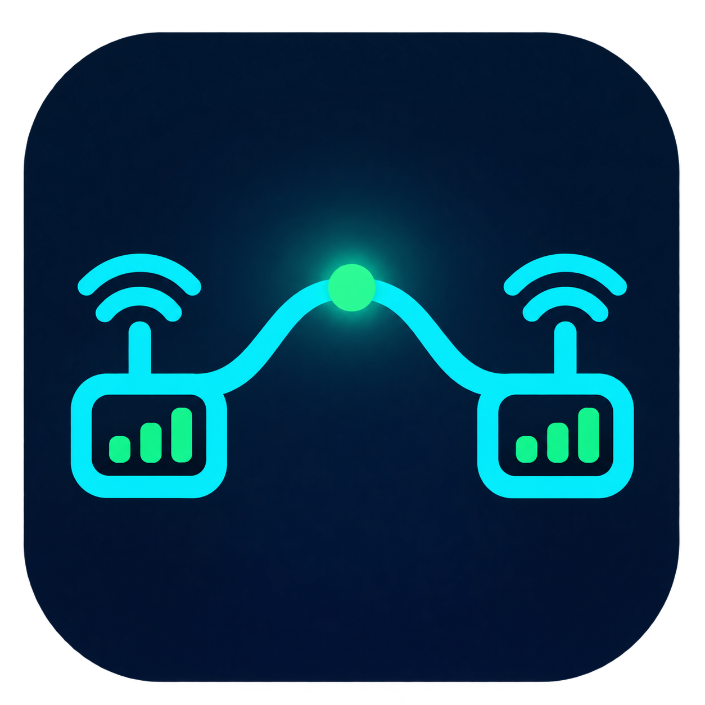
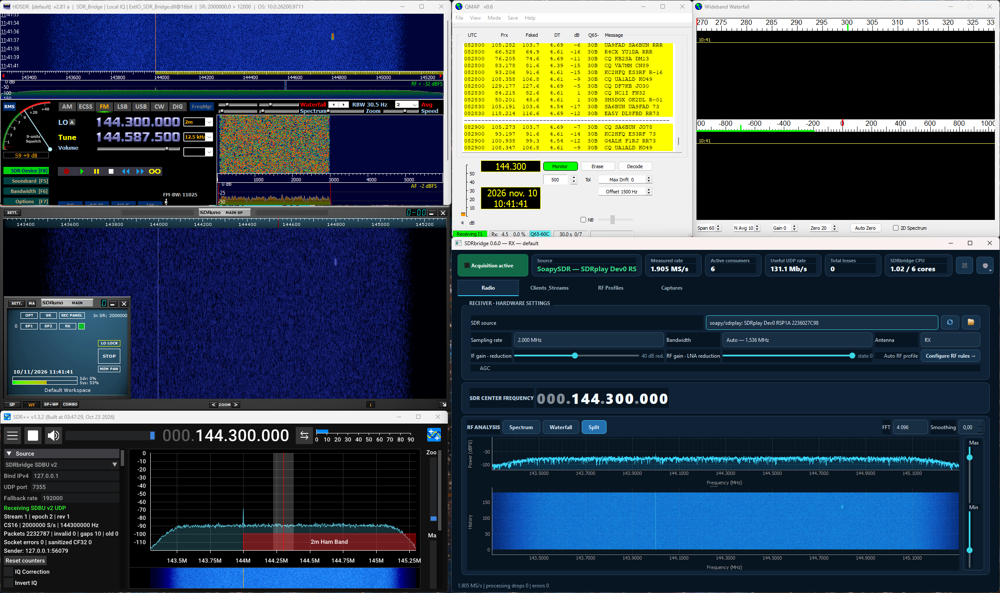

[Documentation française](README_FR.md)

# SDRbridge



SDRbridge is a receive-only distribution bridge for Windows. It opens a single SDR source, publishes its IQ stream, and lets several receiver applications use it simultaneously without giving them control of the radio hardware.

Version 0.6.1 supports a simulated source, SigMF replay, HDSDR or SDR++ IQ WAV/RF64 files, the native SDRplay backend, and a generic SoapySDR backend. Every UDP destination can receive its own effective sample rate. QMAP 0.6 keeps its dedicated 96 kS/s Linrad stream while running alongside SDR++.



*SDRbridge 0.6 qualification setup: HDSDR and SDRuno through the local ExtIO adapter, SDR++ through SDBU v2, and QMAP through Linrad at 96 kS/s. Six consumers are monitored, with 131.1 Mb/s of useful UDP traffic and zero loss. SDRbridge remains the sole RF authority.*

## What the project does

- RX acquisition from one source: native SDRplay, SoapySDR, simulation, SigMF replay, or an IQ WAV/RF64 file;
- local multiprocess distribution through the SDBR v2 shared-memory ring;
- SDBU v2 UDP transport carrying frequency, sample rate, format, sequence, and epoch metadata;
- QMAP/Linrad UDP transport with filtered resampling to 96 kS/s and center-frequency metadata;
- shared `CS16`/`CF32` DSP profiles at output rates such as 2 MS/s, 1 MS/s, 192 kS/s, and 96 kS/s;
- a dark Qt interface with a native Windows title bar for radio settings, clients and streams, RF profiles, and captures; a separate diagnostics window, French/English selection, and a compact view;
- native SDR++ x64 connector, Win32 HDSDR ExtIO adapter, and ANTRACK compatibility shim;
- SigMF 1.2.6 capture and replay;
- strictly receive-only operation: no TX path is enabled.

```text
SDR / simulation / replay / IQ file
          |
      SDRbridge
       /  |  \
 SDBU v2 SDBR v2  SigMF capture
    |       |
  SDR++   HDSDR / SDRuno / ANTRACK   QMAP/Linrad
```

Client applications are read-only. Changing frequency in SDR++ or HDSDR does not retune the RSP: the effective SDRbridge frequency is sent back to the client.

## SDR receiver compatibility

| Receiver | Intended path | Verified status |
|---|---|---|
| SDRplay RSP1A | private SoapySDRPlay3 runtime | Real RX verified at 10 MS/s with simultaneous 4 MS/s and QMAP outputs and no loss |
| SDRplay RSPdx | native SDRplay or SoapySDR backend | Real RX verified at 2 MS/s |
| RSP1 clone / MSI Panadapter | SoapySDRPlay | Real RX verified alone and concurrently with the native RSPdx backend |
| RTL2832 / RTL-SDR | SoapySDR backend with `SoapyRTLSDR` | Implemented in the code, not tested with real hardware |
| Airspy, HackRF, LimeSDR, UHD, etc. | matching SoapySDR module | Potential compatibility, not qualified |

The 0.6.1 installer includes only the `SoapySDRPlay3` hardware module. SDRplay receivers therefore work out of the box, while RTL-SDR, USRP/UHD, Airspy, HackRF, and LimeSDR require their matching Soapy module to be added to and qualified with SDRbridge's private runtime. The computer's system-wide PothosSDR stack is deliberately not loaded.

An RTL2832 device is therefore **not yet qualified with SDRbridge**. It requires at least a suitable WinUSB driver and a `SoapyRTLSDR` module compatible with the private runtime. The receiver must then appear in the **Radio** source list.

PothosSDR exposes the `rtlsdr` factory on the development computer, but no RTL2832 device was connected during qualification. The presence of that software factory is not evidence of real hardware reception.

## Installing SDRbridge

### Simple installation for end users

The current version is **[v0.6.1](https://github.com/stephanerey/SDRbridge/releases/tag/v0.6.1)**. Download `SDRbridge_Setup_0.6.1.exe` from the assets attached to that GitHub release.

## License

SDRbridge is free software distributed under the **GNU GPL v3 or any later version** (`GPL-3.0-or-later`). Copyright © 2026 Stéphane REY F1TJJ and Philippe Borghini F5JWF. See [LICENSE](LICENSE), [AUTHORS.md](AUTHORS.md), and [THIRD_PARTY_NOTICES.md](THIRD_PARTY_NOTICES.md).

The software is provided without warranty. Published binaries are accompanied by the corresponding source code in the GitHub release carrying the same version number.

## Development method and AI disclosure

SDRbridge was developed with the assistance of AI coding tools, under human
direction, code review, hardware testing, and release validation. The project
used Auroramind's [SR Method 4.1](https://github.com/syl2042/Aurora_SR_method_codex_pack)
to structure requirements, implementation passes, evidence, and risk-based
verification. AI assistance does not replace the automated tests and real-radio
qualification documented in this repository.

**Do not copy `SDR_Bridge.exe` by itself.** The current build is a portable directory application: the executable depends on the adjacent DLLs and `_internal` directory. Two distribution methods are supported:

- recommended: the single `SDRbridge_Setup_0.6.1.exe` installer attached to the release;
- portable: a ZIP archive containing the complete `SDR_Bridge` directory, extracted without moving the executable out of that directory.

To use an RSP, the official SDRplay **3.15** driver and API must already be installed. Python, Qt, SoapySDR, and SoapySDRPlay3 are included with SDRbridge; PothosSDR is not required. Install the SDR++ and HDSDR connectors separately as described below.

> The Git repository contains the source code and client DLLs, not the generated `release-v0.x` application packages. Validated installers are published separately as GitHub release assets.

### Building the distribution from source

#### 1. Install the prerequisites

- Windows 10 or 11 x64;
- Git;
- Python 3.12 x64;
- Visual Studio Build Tools with **Desktop development with C++** and CMake;
- [SDRplay API](https://www.sdrplay.com/api/) 3.15 to build or use RSP support;
- Inno Setup 6, optional and only required to produce `Setup.exe`.

#### 2. Clone and prepare the environment

```powershell
git clone https://github.com/stephanerey/SDRbridge.git
cd SDRbridge
py -3.12 -m venv .venv
.\.venv\Scripts\python.exe -m pip install --upgrade pip
.\.venv\Scripts\python.exe -m pip install -r requirements-lock.txt
.\.venv\Scripts\python.exe -m pip install -r packaging\requirements-build.txt
```

#### 3. Build the Windows package

```powershell
.\packaging\build_exe.ps1
```

The script reads the version from `pyproject.toml`, builds the private Soapy stack, compiles the x64/Win32 native components, and writes the result to `release-v0.6`:

- `release-v0.6\SDR_Bridge\SDR_Bridge.exe`: portable application;
- `release-v0.6\SDR_Bridge_Client` and `SDR_Bridge_Native_Client`: diagnostic clients;
- `release-v0.6\Connectors`: SDR++, HDSDR, and ANTRACK connectors with their installation scripts;
- `release-v0.6\installer\SDRbridge_Setup_0.6.1.exe`: installer, when Inno Setup 6 is available.

The application is installed in the user profile (`%LOCALAPPDATA%\Programs\SDRbridge`) and does not require administrator rights. For portable distribution, copy or compress the **entire** `release-v0.6\SDR_Bridge` directory.

#### 4. First start

Test the application without hardware first:

```powershell
.\release-v0.6\SDR_Bridge\SDR_Bridge.exe --source simulated
```

For an RSPdx with the supplied configuration:

```powershell
.\release-v0.6\SDR_Bridge\SDR_Bridge.exe --config .\config.soapy-sdrpp.json
```

The shortcut created by the installer loads `config.soapy-sdrpp.json`, so the **Source** list displays receivers detected by Soapy. Reception remains stopped until **Start** is pressed. Starting `SDR_Bridge.exe` directly without arguments keeps the simulated source as a safe default.

### Capturing an IQ stream

The **Captures** tab offers three formats:

- **SigMF 1.2.6**, as a `.sigmf-data` and `.sigmf-meta` pair;
- **SDR++ WAV**, stereo PCM int16 IQ with the exact frequency in `Hz` in the filename, as expected by SDR++ File Source;
- **HDSDR WAV**, stereo PCM int16 IQ with a SpectraVue/HDSDR `auxi` chunk containing the center frequency and UTC start and end times.

Click **Choose file and start capture…** to open the native Windows **Save As** dialog. Its initial directory is `C:\Projets\SDRBridge\Captures`; the suggested filename contains the date, time, and frequency. The selected output profile sets the effective rate. CF32 profiles are converted to int16 for both WAV formats. A discontinuity stops and finalizes the capture, and an existing file is never overwritten.

The SDR++ and HDSDR formats use the applications' conventional RIFF/WAV container, so each recording is limited to 4 GiB. SigMF remains available for longer recordings.

### Playing an HDSDR or SDR++ IQ file

The file source accepts two-channel IQ WAV/RF64 containers containing `uint8`, `int16`, `int32`, or `float32` samples. The sample rate is read from the file. An explicit `--iq-center-frequency` value takes precedence; otherwise SDRbridge reads the HDSDR/SpectraVue `auxi` chunk and then searches the filename for a frequency such as `103.5MHz` or `144300kHz`.

On the **Radio** tab, open the **Source** list and choose **IQ file… — Browse**, or click the folder button to the right of the list. Select the recording in the Windows file picker. The active SDR source is stopped cleanly and replaced by the file without disconnecting the spectrum or UDP destinations; playback starts automatically. Select the receiver again from the same list to return to live reception.

The status bar then identifies the **IQ file** source. The file is played at its nominal rate and the same UDP destinations remain available. Enable **Loop IQ file** to repeat playback. SigMF replay remains separate and unchanged.

### Configuring independent UDP outputs

In **Clients & Streams**, enter the destination `HOST:PORT`, transport, output rate, maximum datagram size, and queue depth for each client. **Add client** creates a stream; select a row and press **Update selected** to apply new parameters. The output rate cannot exceed the source rate.

Non-loopback destinations are disabled by default. Open **Settings**, enable
**Allow LAN UDP destinations**, then add the remote address. This permission
applies immediately and is saved in the active configuration without exposing
RF control on the LAN. When a loopback datagram size of 8192 bytes is still
selected, entering a LAN endpoint automatically changes it to the safer
1200-byte network budget. The receiving application must bind its LAN address
or `0.0.0.0`, and its host firewall must allow the selected inbound UDP port.

Example with a 2 MS/s source:

| Port | Effective rate | Possible use |
|---:|---:|---|
| 7355 | 2,000,000 S/s | full bandwidth |
| 7356 | 192,000 S/s | narrow-band client |
| 7357 | 1,000,000 S/s | intermediate client |

Destinations with the same rate and format share one DSP process. The default loopback datagram is 8192 bytes to reduce UDP calls; the LAN default remains 1200 bytes to avoid fragmentation. QMAP requires 96 kS/s and 1416-byte datagrams.

The global `buffers.block_samples` performance setting defaults to 32768 samples, approximately 3.3 ms at 10 MS/s or 16.4 ms at 2 MS/s. It can also be overridden at startup with `--block-samples`. Smaller values reduce latency but significantly increase DSP and UDP call rates. This value cannot be changed while acquisition is running.

### Logs and shutdown diagnostics

SDRbridge automatically writes rotating JSON logs to:

```text
%LOCALAPPDATA%\SDRbridge\logs\sdrbridge.log
```

The five previous archives are retained, with a maximum size of 5 MiB per file. Every run has a `run_id` shared by the log and native control interface. Starts, stops, source errors, queue losses, and uncaught Python exceptions are recorded without IQ data or session tokens.

Native faults that Python can intercept are written separately to `sdrbridge-fault.log`. The current log path is also displayed in **Diagnostics**. For an isolated development run, `--log-dir PATH` selects a different directory.

### Multiple instances and multiple SDRs

Version 0.6 keeps one active source per process. Several processes can run concurrently with separate instance names, port offsets, rings, and logs. The verified reference configuration uses the RSPdx through the native backend and the RSP1 through Soapy.

```powershell
.\start-sdrbridge.ps1 -Instance rspdx -Config .\config.native-sdrpp.json
.\start-sdrbridge.ps1 -Instance rsp1 -PortOffset 100 `
  -Config .\config.soapy-sdrpp.json `
  -DeviceId 'soapy:sdrplay:0000000001'
```

The first instance uses ports `47631`/`47632` and UDP `7355`. The second uses `47731`/`47732` and UDP `7455`. Its logs are stored under `%LOCALAPPDATA%\SDRbridge\instances\rsp1\logs`.

SDRbridge 0.6 uses its own SoapySDR 0.9 / SoapySDRPlay3 0.5.2 stack built against SDRplay API 3.15 and does not load the global PothosSDR stack. This isolation avoids conflicts with SDR++, QMAP, and ANTRACK. A future ANTRACK release should follow the same approach with its own qualified runtime instead of sharing SDRbridge DLLs.

## Installing the SDR++ source

The custom source was built for **SDR++ 1.3.0 x64**. The prebuilt DLL is [`clients/sdrpp_sdbu_source/bin/sdbu_source.dll`](clients/sdrpp_sdbu_source/bin/sdbu_source.dll).

1. Close SDR++.
2. From PowerShell at the repository root, run the installer script with the SDR++ installation path:

```powershell
.\clients\sdrpp_sdbu_source\scripts\install.ps1 `
  -SdrppRoot 'E:\Radio\sdrpp_windows_x64_1.3.0\sdrpp_windows_x64'
```

3. Restart SDR++ and select **SDRbridge SDBU v2** under **Source**.
4. Keep `127.0.0.1` and select a UDP port, `7355` by default.
5. In SDRbridge, add a UDP destination for the same port using the `sdbu_v2` transport.

Every local SDR++ instance must use its own UDP port. The script backs up `config.json`, installs the DLL in `modules`, and creates a manifest. To roll back:

```powershell
.\clients\sdrpp_sdbu_source\scripts\uninstall.ps1 `
  -SdrppRoot 'E:\Radio\sdrpp_windows_x64_1.3.0\sdrpp_windows_x64'
```

Build details and limitations are documented in the [SDR++ connector README](clients/sdrpp_sdbu_source/README.md).

## Installing the HDSDR ExtIO adapter

HDSDR is a 32-bit application, so it requires the prebuilt Win32 [`native/extio_bridge/bin/ExtIO_SDR_Bridge.dll`](native/extio_bridge/bin/ExtIO_SDR_Bridge.dll).

1. Close HDSDR.
2. Open PowerShell as administrator at the repository root.
3. Install the DLL in the HDSDR directory:

```powershell
.\native\extio_bridge\scripts\install.ps1
```

The default path is `C:\Program Files (x86)\HDSDR`. For a portable installation:

```powershell
.\native\extio_bridge\scripts\install.ps1 -HdsdrRoot 'D:\Radio\HDSDR'
```

4. Start SDRbridge before HDSDR.
5. In HDSDR, select `ExtIO_SDR_Bridge.dll`, then click **Start**.

The ExtIO adapter connects to local control endpoint `127.0.0.1:47631`, opens the SDBR v2 ring, and notifies HDSDR when the center frequency or sample rate changes. It rejects tuning requests from HDSDR so that SDRbridge remains the RF authority.

### ExtIO transport and sample rate

HDSDR does not receive IQ through a UDP destination. Ports `7355`, `7356`, and similar ports therefore do not apply to HDSDR and cannot be configured in it. Port `47631` is used only for local registration and control; `CS16` samples then travel through the SDBR v2 shared-memory ring.

The 0.6 ExtIO adapter attaches to the master ring and does not select a decimated profile. Every HDSDR instance therefore receives the complete source rate: a source at 2 MS/s, 4 MS/s, or 10 MS/s is presented to HDSDR at that same rate. HDSDR can perform its own internal processing, but it does not reduce the rate read from SDRbridge.

HDSDR appears under **Active consumers** and adds its rate to the **Logical IQ rate**. It does not increase **Useful UDP rate** or **Measured network rate**. With `CS16`, 2 MS/s represents 64 Mb/s of logical traffic per reader. Several HDSDR processes read the same ring, which SDRbridge writes only once; every HDSDR process still performs its own copies, FFT, waterfall, and demodulation. On the SDRbridge side, four ExtIO readers therefore generally cost less than four equivalent UDP destinations, although they are not free for the computer's overall CPU and memory usage.

The DLL is a Win32 ExtIO adapter. **HDSDR 2.81a and SDRuno 1.42.1710 in ExtIO mode are the certified hosts for version 0.6.** Other Win32 applications that genuinely implement the same ExtIO ABI may be candidates, but are not declared compatible without explicit testing.

### Using the same ExtIO adapter with SDRuno

SDRuno has reached end of life at SDRplay; its last official version is 1.42.1710. Its installer includes `SDRuno.EXTIO.exe` and SDRplay API 3.15. Close SDRbridge and any application using the RSP before a full installation so that the API installer can complete normally.

1. Copy the same Win32 `ExtIO_SDR_Bridge.dll` to `C:\Program Files (x86)\SDRplay\SDRuno` with administrator rights.
2. Start SDRbridge and its acquisition.
3. Run **`SDRuno.EXTIO.exe`**, never `SDRuno.exe` for this path.
4. Check that **In SR** displays the source rate, then press **PLAY** and open **SP1**.

SDRuno then uses the same `127.0.0.1:47631` control endpoint and master ring as HDSDR. It appears as a separate local consumer, with no UDP destination and no per-client decimation. The real 0.6 qualification verified `In SR: 2000000`, PLAY → STOP, a live SP1 spectrum, and a separate local TCP connection to `47631`.

To restore the previous DLL:

```powershell
.\native\extio_bridge\scripts\uninstall.ps1
```

See the [ExtIO README](native/extio_bridge/README.md) for build and native-test details.

## Development and direct source execution

To work without rebuilding the PyInstaller package after every change:

```powershell
py -3.12 -m venv .venv
.\.venv\Scripts\python.exe -m pip install -r requirements-lock.txt
.\native\build_native.ps1
.\run_bridge.ps1 -Source simulated
```

Hardware startup is explicit:

```powershell
.\run_bridge.ps1 -Source native
```

After the local portable package has been built, start it with `start-sdrbridge.ps1`. The script uses `config.soapy-sdrpp.json` by default and accepts `-Instance`, `-PortOffset`, `-Config`, and `-DeviceId`.

## Verification

```powershell
.\run_tests.ps1
```

Status verified on November 10, 2026: all 90 application tests pass. A real RSP1A sustained a 10 MS/s source with a 4 MS/s SDBU output and QMAP at 96 kS/s, with no source, DSP, profile, or UDP loss. Visual qualification at 2 MS/s simultaneously covers HDSDR 2.81a, SDRuno 1.42.1710, SDR++ 1.3.2, and QMAP 0.6; six consumers are monitored and the global loss counter remains at zero. Three real HDSDR recordings were replayed; replay of a real SDR++ recording and the long endurance test remain open.

## Documentation

- [Illustrated technical overview of version 0.6](docs/TECHNICAL_OVERVIEW.md)
- [Development entry point](docs/START_HERE.md)
- [Verified current state and limitations](docs/work/CURRENT_STATE.md)
- [v0.3 execution contract](docs/specs/06_IMPLEMENTATION_BASELINE.md)
- [Product requirements document](docs/product/PRD.md)
- [Qualification report](docs/verification/QUALIFICATION_REPORT.md)
- [SDR++ SDBU v2 connector](clients/sdrpp_sdbu_source/README.md)
- [SDRbridge ExtIO adapter for HDSDR](native/extio_bridge/README.md)

Repository: [stephanerey/SDRbridge](https://github.com/stephanerey/SDRbridge).
