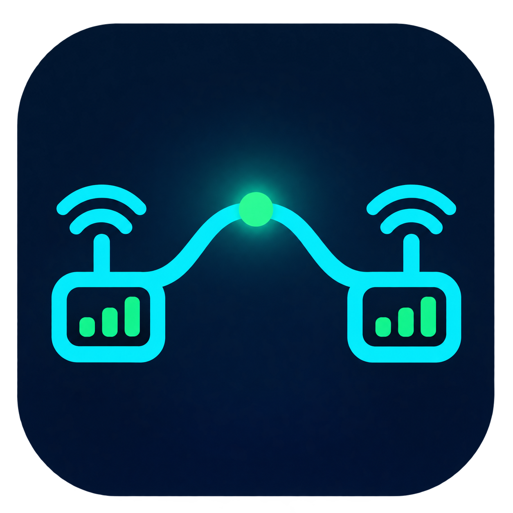
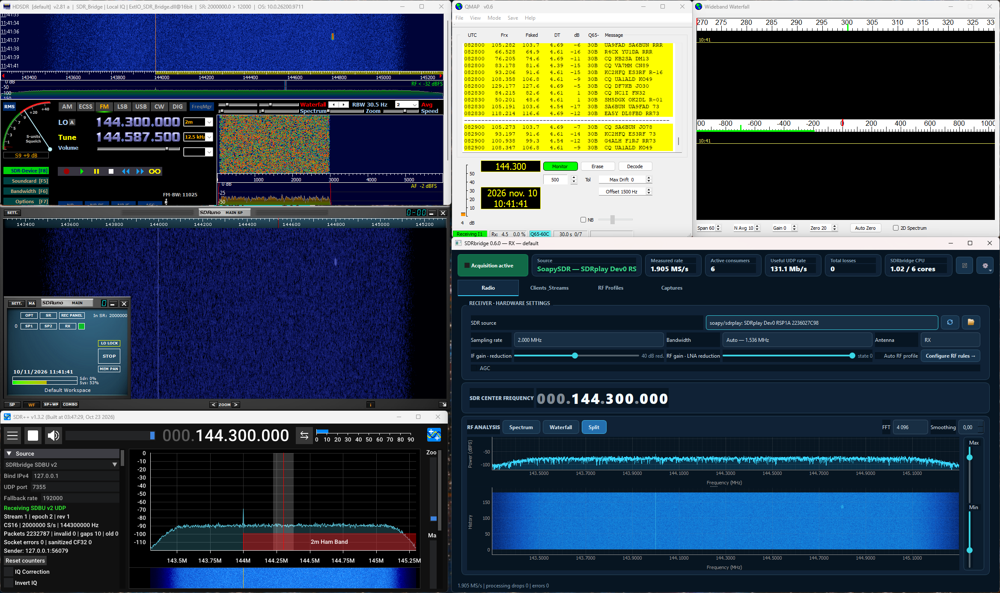

[English documentation](README.md)

# SDRbridge



SDRbridge est un répartiteur RX pour Windows : il ouvre une seule source SDR, publie son flux IQ et permet à plusieurs applications de réception de l’utiliser simultanément sans leur donner le contrôle du matériel.

La version 0.7.0 ajoute les modules de réception SoapySDR génériques isolés, le choix automatique du transport IQ selon le débit, un chemin hôte SC8 de bout en bout à haut débit, la réouverture sûre du périphérique lors des changements de débit à chaud, une cascade DSP haut débit accélérée par FFT et des réserves d'ordonnancement accrues. Chaque destination UDP peut recevoir son propre débit effectif. QMAP 0.6 conserve son flux Linrad dédié à 96 kS/s, simultanément avec SDR++.



*Chaîne de qualification 0.6 : HDSDR et SDRuno via l’ExtIO locale, SDR++ via SDBU v2 et QMAP via Linrad 96 kS/s. Six consommateurs sont supervisés, avec 131,1 Mb/s UDP utiles et zéro perte. SDRbridge reste l’unique autorité RF.*

## Ce que fait le projet

- acquisition RX depuis une source unique : SDRplay natif, SoapySDR, simulation, replay SigMF ou fichier IQ WAV/RF64 ;
- distribution locale multiprocessus par ring partagé SDBR v2 ;
- transport UDP SDBU v2 avec métadonnées de fréquence, taux, format, séquence et époque ;
- transport QMAP/Linrad UDP avec resampling filtré à 96 kS/s et fréquence centrale transmise ;
- profils DSP `CS16`/`CF32` mutualisés par débit de sortie, par exemple 2 MS/s, 1 MS/s, 192 kS/s et 96 kS/s ;
- interface Qt sombre à barre Windows native pour la radio, les clients et flux, les profils RF et les captures ; diagnostics en fenêtre dédiée, langue Français/English et vue compacte ;
- connecteur natif SDR++ x64, ExtIO HDSDR Win32 et shim ANTRACK ;
- capture et replay SigMF 1.2.6 ;
- fonctionnement strictement RX : aucun chemin TX n’est activé.

```text
SDR / simulation / replay / fichier IQ
          |
      SDRbridge
       /  |  \
 SDBU v2 SDBR v2  capture SigMF
    |       |
  SDR++   HDSDR / SDRuno / ANTRACK   QMAP/Linrad
```

Les applications clientes sont en lecture seule. Changer une fréquence dans SDR++ ou HDSDR ne reconfigure pas le RSPdx : la valeur effective du bridge est réappliquée au client.

## Compatibilité avec les récepteurs SDR

SDRbridge construit ses contrôles à partir des capacités exposées par le
récepteur SoapySDR sélectionné. Il ne contient aucune table de contrôles par
modèle. L'installateur 0.7.0 fournit des modules de réception isolés pour
SDRplay, RTL-SDR, Airspy, Airspy HF+, LimeSDR, ADALM-Pluto et UHD/USRP.

L'utilisateur reste responsable de l'installation et de la validation du
pilote, de l'API, du firmware et des images matérielles du constructeur avant
de démarrer SDRbridge. SDRbridge ne remplace ni ne modifie cette pile. La seule
présence d'une factory Soapy ne prouve pas que le récepteur physique fonctionne.

Consultez la [matrice de validation matérielle](docs/HARDWARE_COMPATIBILITY_FR.md),
mise à jour au fil des essais, ainsi que la [procédure de qualification
générique](docs/verification/GENERIC_SOAPY_VALIDATION.md).

## Installer SDRbridge

### Installation simple pour un utilisateur final

La version courante est la **[v0.7.0](https://github.com/stephanerey/SDRbridge/releases/tag/v0.7.0)**. L'installateur `SDRbridge_Setup_0.7.0.exe` est fourni comme fichier joint à cette release GitHub.

## Licence

SDRbridge est un logiciel libre distribué sous **GNU GPL v3 ou toute version
ultérieure** (`GPL-3.0-or-later`). Copyright © 2026 Stéphane REY F1TJJ et
Philippe Borghini F5JWF. Consultez [LICENSE](LICENSE), [AUTHORS.md](AUTHORS.md)
et [THIRD_PARTY_NOTICES.md](THIRD_PARTY_NOTICES.md).

Le logiciel est fourni sans garantie. Les binaires d'une version publiée sont
accompagnés du code source correspondant dans la release GitHub portant le même
numéro de version.

## Méthode de développement et transparence sur l'IA

SDRbridge a été développé avec l'assistance d'outils d'intelligence
artificielle, sous direction humaine, avec revue du code, essais matériels et
validation des versions. Le projet a utilisé la
[SR Method 4.1](https://github.com/syl2042/Aurora_SR_method_codex_pack)
d'[Auroramind](https://www.auroramind.fr/)
pour structurer les exigences, les passes d'implémentation, les preuves et les
vérifications proportionnées aux risques. L'assistance IA ne remplace pas les
tests automatisés et les qualifications sur récepteurs réels documentés dans ce
dépôt.

**`SDR_Bridge.exe` ne doit pas être copié seul.** Le build actuel est une application portable « en dossier » : l’exécutable dépend des DLL et du répertoire `_internal` placés à côté de lui. Deux distributions sont donc possibles :

- recommandée : le fichier unique `SDRbridge_Setup_0.7.0.exe` après publication de la release ;
- portable : une archive ZIP contenant le dossier `SDR_Bridge` complet, à extraire sans déplacer l’exécutable hors de ce dossier.

Pour utiliser un RSP, le pilote et l’API SDRplay officiels **3.15** doivent être installés sur le PC. Python, Qt, SoapySDR et SoapySDRPlay3 sont inclus dans SDRbridge : PothosSDR n'est pas requis. Les connecteurs SDR++ et HDSDR s’installent ensuite avec les procédures dédiées plus bas.

> Le dépôt Git versionne les sources et les DLL clientes, pas les paquets principaux générés `release-v0.x`. Les installateurs validés sont publiés séparément comme fichiers joints aux releases GitHub.

### Construire la distribution depuis les sources

#### 1. Installer les prérequis

- Windows 10 ou 11 x64 ;
- Git ;
- Python 3.12 x64 ;
- Visual Studio Build Tools avec **Développement Desktop en C++** et CMake ;
- les fichiers de développement PothosSDR x64, utilisés uniquement pour
  construire les adaptateurs matériels génériques et jamais comme cœur Soapy
  de SDRbridge ;
- l’[API SDRplay](https://www.sdrplay.com/api/) 3.15 pour construire ou utiliser le support des RSP ;
- Inno Setup 6, facultatif, uniquement pour produire un assistant `Setup.exe`.

#### 2. Cloner et préparer l’environnement

```powershell
git clone https://github.com/stephanerey/SDRbridge.git
cd SDRbridge
py -3.12 -m venv .venv
.\.venv\Scripts\python.exe -m pip install --upgrade pip
.\.venv\Scripts\python.exe -m pip install -r requirements-lock.txt
.\.venv\Scripts\python.exe -m pip install -r packaging\requirements-build.txt
```

#### 3. Construire le paquet Windows

```powershell
.\packaging\build_exe.ps1
```

Le script lit la version dans `pyproject.toml`, construit la pile Soapy privée, compile les composants natifs x64/Win32 et place le résultat dans `release-v0.7` :

- `release-v0.7\SDR_Bridge\SDR_Bridge.exe` : application portable ;
- `release-v0.7\SDR_Bridge_Client` et `SDR_Bridge_Native_Client` : clients de diagnostic ;
- `release-v0.7\Connectors` : connecteurs SDR++, HDSDR et ANTRACK, avec leurs scripts d’installation ;
- `release-v0.7\installer\SDRbridge_Setup_0.7.0.exe` : installateur créé si Inno Setup 6 est présent.

`packaging\build_soapy_runtime.ps1` peut aussi être exécuté seul sur un PC de
test SDR générique. Il télécharge un SDK Boost 1.75 épinglé après vérification
de son SHA-256 et construit les modules privés ABI 0.8. Si le SDK SDRplay est
absent, seul le module SDRplay est omis ; UHD, RTL-SDR, Airspy, Lime et Pluto
restent constructibles.

L’application est installée dans le profil utilisateur (`%LOCALAPPDATA%\Programs\SDRbridge`) et ne demande pas de droits administrateur. Pour une distribution portable, copier ou compresser **tout** le dossier `release-v0.7\SDR_Bridge`.

#### 4. Premier démarrage

Tester d’abord l’application sans matériel :

```powershell
.\release-v0.7\SDR_Bridge\SDR_Bridge.exe --source simulated
```

Pour le RSPdx avec la configuration fournie :

```powershell
.\release-v0.7\SDR_Bridge\SDR_Bridge.exe --config .\config.soapy-sdrpp.json
```

Le raccourci créé par l’installateur charge `config.soapy-sdrpp.json` : la liste **Source** contient donc les SDR détectés par Soapy. La réception reste arrêtée jusqu’au clic sur **Start**. Un lancement direct de `SDR_Bridge.exe` sans argument conserve la source simulée comme mode sûr.

### Capturer un flux IQ

L'onglet **Captures** propose trois formats :

- **SigMF 1.2.6**, sous la forme d'une paire `.sigmf-data` et `.sigmf-meta` ;
- **SDR++ WAV**, en IQ stéréo PCM int16, avec la fréquence exacte en `Hz` dans le nom de fichier comme l'attend le File Source de SDR++ ;
- **HDSDR WAV**, en IQ stéréo PCM int16 avec un chunk `auxi` SpectraVue/HDSDR contenant la fréquence centrale et les heures UTC de début et de fin.

Cliquer sur **Choose file and start capture…** ouvre la boîte Windows **Enregistrer sous**. Le dossier initial est `C:\Projets\SDRBridge\Captures`; le nom proposé contient la date, l'heure et la fréquence. Le profil de sortie choisi fixe le débit effectif. Un profil CF32 est converti en int16 dans les deux formats WAV. Une discontinuité arrête et finalise la capture, et un fichier existant n'est jamais écrasé.

Les formats SDR++ et HDSDR suivent le conteneur RIFF/WAV classique de ces applications ; une capture est donc limitée à 4 Gio. SigMF reste disponible pour les enregistrements plus longs.

### Lire un fichier IQ HDSDR ou SDR++

La source fichier accepte les conteneurs WAV/RF64 à deux canaux I/Q, aux formats `uint8`, `int16`, `int32` ou `float32`. Le taux d'échantillonnage est lu dans le fichier. Une valeur `--iq-center-frequency` explicite est prioritaire ; sinon SDRbridge lit le bloc HDSDR/SpectraVue `auxi`, puis recherche la fréquence dans le nom (`103.5MHz`, `144300kHz`, etc.).

Dans l'onglet **Radio**, ouvrir la liste **Source** puis choisir **Fichier IQ… — Parcourir**, ou cliquer directement sur le bouton dossier placé à droite de la liste. L'explorateur Windows permet alors de sélectionner l'enregistrement. La source SDR active est arrêtée proprement et remplacée par le fichier sans déconnecter le spectre ni les destinations UDP ; la lecture démarre automatiquement. Pour revenir au récepteur, le sélectionner à nouveau dans la même liste.

La barre d'état indique alors **Fichier IQ …**. Le fichier est lu à sa cadence nominale et les mêmes destinations UDP que pour un SDR réel restent disponibles. La case **Loop IQ file** permet de boucler la lecture. Le replay SigMF reste séparé et inchangé.

### Régler les sorties UDP indépendamment

Dans **Outputs & Clients**, saisir pour chaque client : l'adresse `HOST:PORT`, le transport, le débit de sortie, la taille maximale d'un datagramme et la profondeur de file. **Add client** crée le flux ; sélectionner une ligne puis **Update selected** applique de nouveaux paramètres. Le débit ne peut pas dépasser celui de la source.

Les destinations hors de la boucle locale sont désactivées par défaut. Ouvrir
**Paramètres**, activer **Autoriser UDP LAN**, puis ajouter l'adresse distante.
Cette autorisation s'applique immédiatement et est enregistrée dans la
configuration active sans exposer le contrôle RF sur le LAN. Si la taille
loopback de 8192 octets est encore sélectionnée, la saisie d'une destination
LAN la ramène automatiquement au budget réseau plus sûr de 1200 octets.
L'application réceptrice doit écouter sur son adresse LAN ou `0.0.0.0`, et son
pare-feu doit autoriser le port UDP entrant choisi.

Exemple avec une source à 2 MS/s :

| Port | Débit effectif | Usage possible |
|---:|---:|---|
| 7355 | 2 000 000 S/s | largeur complète |
| 7356 | 192 000 S/s | client bande réduite |
| 7357 | 1 000 000 S/s | client intermédiaire |

Les destinations de même débit et de même format partagent le même traitement DSP. Sur loopback, la taille par défaut est 8192 octets pour réduire les appels UDP ; sur le LAN elle reste à 1200 octets pour éviter la fragmentation. QMAP impose 96 kS/s et 1416 octets.

Le réglage de performance global `buffers.block_samples` vaut 32768 par défaut (environ 3,3 ms à 10 MS/s ou 16,4 ms à 2 MS/s). Il est aussi surchargeable au démarrage avec `--block-samples`. Une valeur plus petite réduit la latence mais augmente nettement le nombre d'appels DSP et UDP ; elle ne peut pas être changée pendant une acquisition.

### Journaux et diagnostic d’arrêt

SDRbridge écrit automatiquement des journaux JSON rotatifs dans :

```text
%LOCALAPPDATA%\SDRbridge\logs\sdrbridge.log
```

Les cinq archives précédentes sont conservées, avec une taille maximale de 5 Mio par fichier. Chaque exécution possède un `run_id` commun au journal et au contrôle natif. Les démarrages, arrêts, erreurs de source, pertes de file et exceptions Python non interceptées y sont enregistrés sans données IQ ni jeton de session.

Les fautes natives que Python peut intercepter sont écrites séparément dans `sdrbridge-fault.log`. Le chemin du journal courant apparaît aussi dans l’onglet **Diagnostics**. Pour une exécution de développement isolée, `--log-dir PATH` permet de choisir un autre dossier.

### Plusieurs instances et plusieurs SDR

La v0.6 conserve une source active par processus. Plusieurs processus peuvent fonctionner simultanément grâce à un nom d’instance, des ports décalés, des rings distincts et des journaux séparés. Sur la machine de référence, la combinaison vérifiée est : RSPdx par le backend natif et RSP1 par Soapy.

```powershell
.\start-sdrbridge.ps1 -Instance rspdx -Config .\config.native-sdrpp.json
.\start-sdrbridge.ps1 -Instance rsp1 -PortOffset 100 `
  -Config .\config.soapy-sdrpp.json `
  -DeviceId 'soapy:sdrplay:0000000001'
```

La première instance utilise les ports `47631`/`47632` et UDP `7355`. La seconde utilise `47731`/`47732` et UDP `7455`. Ses journaux se trouvent sous `%LOCALAPPDATA%\SDRbridge\instances\rsp1\logs`.

SDRbridge 0.7 utilise un runtime SoapySDR 0.8.1 privé à l'application et des modules de réception privés, dont SoapySDRPlay3 construit contre l'API SDRplay 3.15. Il ne charge pas les modules de l'installation PothosSDR globale. Cette isolation évite les conflits avec SDR++, QMAP et ANTRACK. La prochaine version d'ANTRACK devra adopter le même principe avec son propre runtime qualifié, sans partager les DLL de SDRbridge.

## Installer la source SDR++

La source personnalisée a été construite pour **SDR++ 1.3.0 x64**. La DLL précompilée est [`clients/sdrpp_sdbu_source/bin/sdbu_source.dll`](clients/sdrpp_sdbu_source/bin/sdbu_source.dll).

1. Fermer SDR++.
2. Depuis PowerShell à la racine du dépôt, lancer le script avec le chemin de l’installation SDR++ :

```powershell
.\clients\sdrpp_sdbu_source\scripts\install.ps1 `
  -SdrppRoot 'E:\Radio\sdrpp_windows_x64_1.3.0\sdrpp_windows_x64'
```

3. Redémarrer SDR++ et sélectionner **SDRbridge SDBU v2** dans **Source**.
4. Conserver `127.0.0.1` et choisir un port UDP, par défaut `7355`.
5. Dans SDRbridge, ajouter une destination UDP vers ce même port avec le transport `sdbu_v2`.

Chaque instance SDR++ locale doit utiliser son propre port UDP. Le script sauvegarde `config.json`, installe la DLL dans `modules` et crée un manifeste. Le retour arrière est disponible avec :

```powershell
.\clients\sdrpp_sdbu_source\scripts\uninstall.ps1 `
  -SdrppRoot 'E:\Radio\sdrpp_windows_x64_1.3.0\sdrpp_windows_x64'
```

Les détails de compilation et les limites sont dans le [README du connecteur SDR++](clients/sdrpp_sdbu_source/README.md).

## Installer l’ExtIO HDSDR

HDSDR est une application 32 bits ; il faut donc utiliser la DLL Win32 précompilée [`native/extio_bridge/bin/ExtIO_SDR_Bridge.dll`](native/extio_bridge/bin/ExtIO_SDR_Bridge.dll).

1. Fermer HDSDR.
2. Ouvrir PowerShell en tant qu’administrateur depuis la racine du dépôt.
3. Installer la DLL dans le dossier HDSDR :

```powershell
.\native\extio_bridge\scripts\install.ps1
```

Le chemin par défaut est `C:\Program Files (x86)\HDSDR`. Pour une version portable :

```powershell
.\native\extio_bridge\scripts\install.ps1 -HdsdrRoot 'D:\Radio\HDSDR'
```

4. Démarrer SDRbridge avant HDSDR.
5. Dans HDSDR, sélectionner `ExtIO_SDR_Bridge.dll`, puis cliquer sur **Start**.

L’ExtIO se connecte au contrôle local `127.0.0.1:47631`, ouvre le ring SDBR v2 et notifie HDSDR lorsque la fréquence centrale ou le taux d’échantillonnage change. Elle refuse les demandes de syntonisation provenant de HDSDR afin de conserver SDRbridge comme autorité RF.

### Transport et débit de l’ExtIO

HDSDR ne reçoit pas son IQ par une destination UDP. Les ports `7355`, `7356`,
etc. ne le concernent donc pas et ne se configurent pas dans HDSDR. Le port
`47631` sert uniquement à l’enregistrement et au contrôle local ; les
échantillons `CS16` passent ensuite par le ring SDBR v2 en mémoire partagée.

L’ExtIO 0.6 s’attache au ring maître, sans sélectionner de profil décimé. Chaque
instance HDSDR reçoit donc le débit complet de la source : une source à
2 MS/s, 4 MS/s ou 10 MS/s est présentée à HDSDR au même débit. HDSDR peut
effectuer ses propres traitements internes, mais il ne réduit pas le débit lu
dans SDRbridge.

Un HDSDR apparaît dans **Consommateurs actifs** et ajoute son débit au
**Débit IQ logique**. Il n’augmente ni le **Débit UDP utile** ni le **Débit
réseau mesuré**. En `CS16`, 2 MS/s représentent 64 Mb/s logiques par lecteur.
Plusieurs HDSDR lisent le même ring que SDRbridge n’écrit qu’une fois ; chaque
processus HDSDR effectue néanmoins ses propres copies, FFT, waterfall et
démodulation. Côté SDRbridge, quatre lecteurs ExtIO coûtent donc généralement
moins cher que quatre destinations UDP équivalentes, sans être gratuits pour
le CPU et la mémoire de la machine entière.

La DLL est une ExtIO Win32. **HDSDR 2.81a et SDRuno 1.42.1710 en mode ExtIO
sont les hôtes certifiés pour la version 0.6.** D’autres applications Win32
implémentant réellement la même ABI ExtIO peuvent être candidates ; elles ne
sont pas déclarées compatibles avant un essai explicite.

### Utiliser la même ExtIO avec SDRuno

SDRuno est en fin de vie chez SDRplay ; sa dernière version officielle est
1.42.1710. Son installateur inclut `SDRuno.EXTIO.exe` et l’API SDRplay 3.15.
Fermer SDRbridge et les applications utilisant le RSP avant une installation
complète afin que l’installeur de l’API puisse terminer normalement.

1. Copier la même DLL Win32 `ExtIO_SDR_Bridge.dll` dans
   `C:\Program Files (x86)\SDRplay\SDRuno` avec les droits administrateur.
2. Démarrer SDRbridge et son acquisition.
3. Lancer **`SDRuno.EXTIO.exe`**, jamais `SDRuno.exe` pour ce parcours.
4. Vérifier que **In SR** affiche le débit source, puis cliquer sur **PLAY** et
   ouvrir **SP1**.

SDRuno utilise alors exactement le même contrôle `127.0.0.1:47631` et le même
ring maître que HDSDR. Il apparaît comme un consommateur local distinct, sans
destination UDP et sans décimation par client. La recette réelle 0.6 a validé
`In SR: 2000000`, le passage PLAY → STOP, un spectre SP1 alimenté et une
connexion TCP locale établie vers `47631`.

Pour restaurer la DLL précédente :

```powershell
.\native\extio_bridge\scripts\uninstall.ps1
```

Voir le [README ExtIO](native/extio_bridge/README.md) pour la compilation et le test natif.

## Développement et lancement direct depuis les sources

Pour travailler sans reconstruire le paquet PyInstaller à chaque modification :

```powershell
py -3.12 -m venv .venv
.\.venv\Scripts\python.exe -m pip install -r requirements-lock.txt
.\native\build_native.ps1
.\run_bridge.ps1 -Source simulated
```

Le lancement matériel est explicite :

```powershell
.\run_bridge.ps1 -Source native
```

Le paquet portable local, lorsqu’il a été construit, se lance avec `start-sdrbridge.ps1`. Le script utilise `config.soapy-sdrpp.json` par défaut et accepte `-Instance`, `-PortOffset`, `-Config` et `-DeviceId`.

## Vérifier

```powershell
.\run_tests.ps1
```

État vérifié au 10 novembre 2026 : 90/90 tests applicatifs passent. Le RSP1A réel a tenu 10 MS/s avec une sortie SDBU 4 MS/s et QMAP 96 kS/s sans perte source, DSP, profil ou UDP. La recette visuelle à 2 MS/s valide simultanément HDSDR 2.81a, SDRuno 1.42.1710, SDR++ 1.3.2 et QMAP 0.6 ; six consommateurs sont supervisés et le compteur global reste à zéro perte. Trois enregistrements HDSDR réels ont été relus ; un enregistrement SDR++ réel et le test d’endurance long restent ouverts.

## Documentation

- [Vue technique illustrée de la version 0.6](docs/TECHNICAL_OVERVIEW.md)
- [Point d’entrée du développement](docs/START_HERE.md)
- [État réel et réserves](docs/work/CURRENT_STATE.md)
- [Contrat d’exécution v0.3](docs/specs/06_IMPLEMENTATION_BASELINE.md)
- [PRD](docs/product/PRD.md)
- [Rapport de qualification](docs/verification/QUALIFICATION_REPORT.md)
- [Connecteur SDR++ SDBU v2](clients/sdrpp_sdbu_source/README.md)
- [ExtIO SDRbridge pour HDSDR](native/extio_bridge/README.md)

Dépôt : [stephanerey/SDRbridge](https://github.com/stephanerey/SDRbridge).
