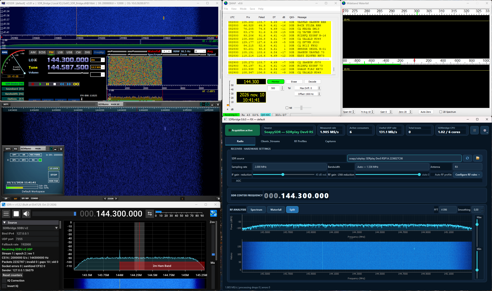
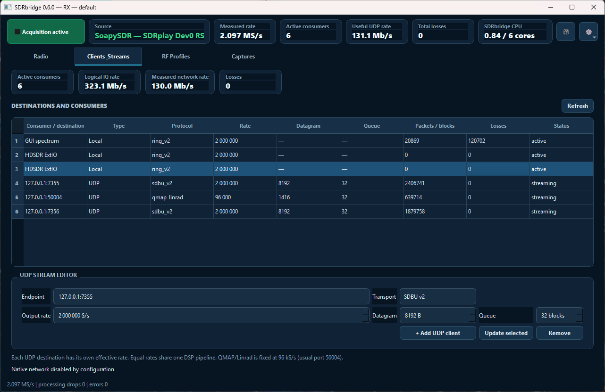
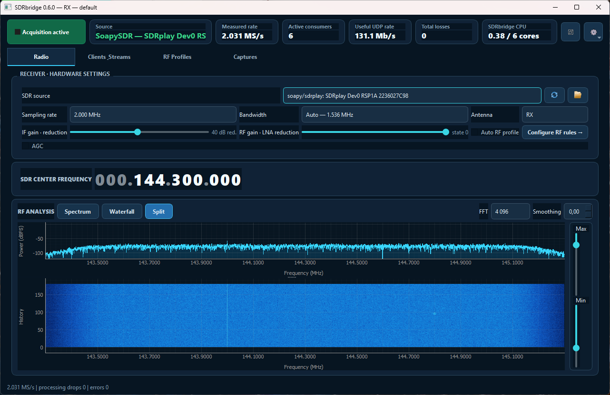
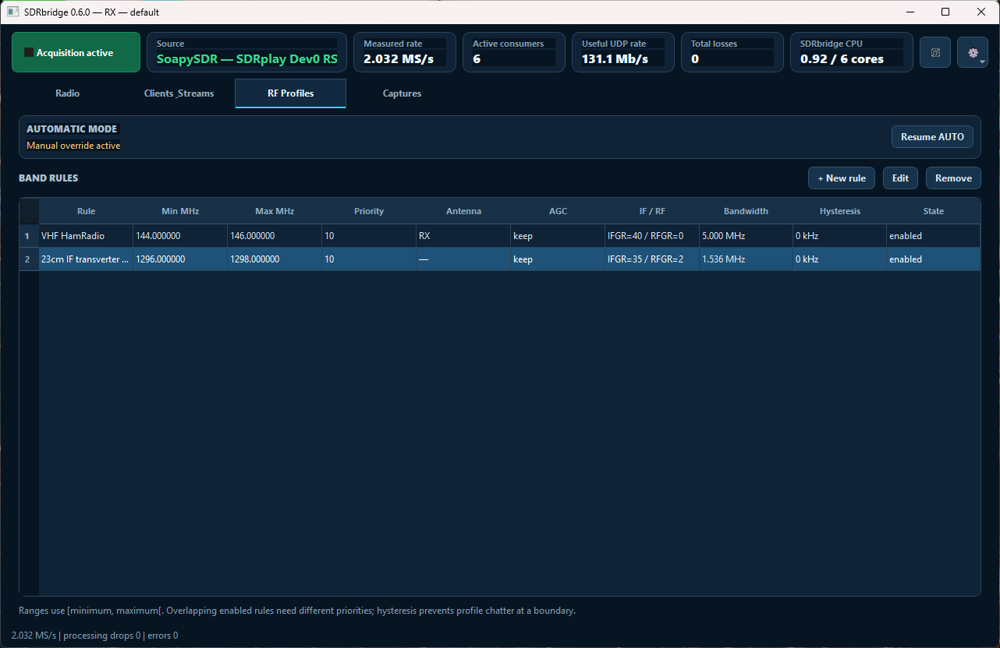
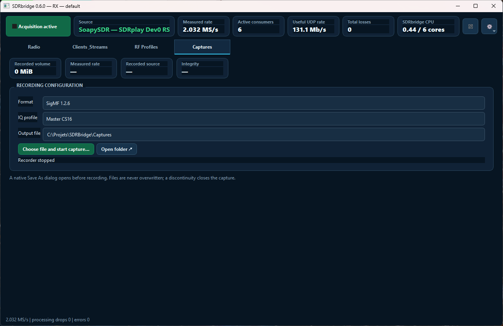
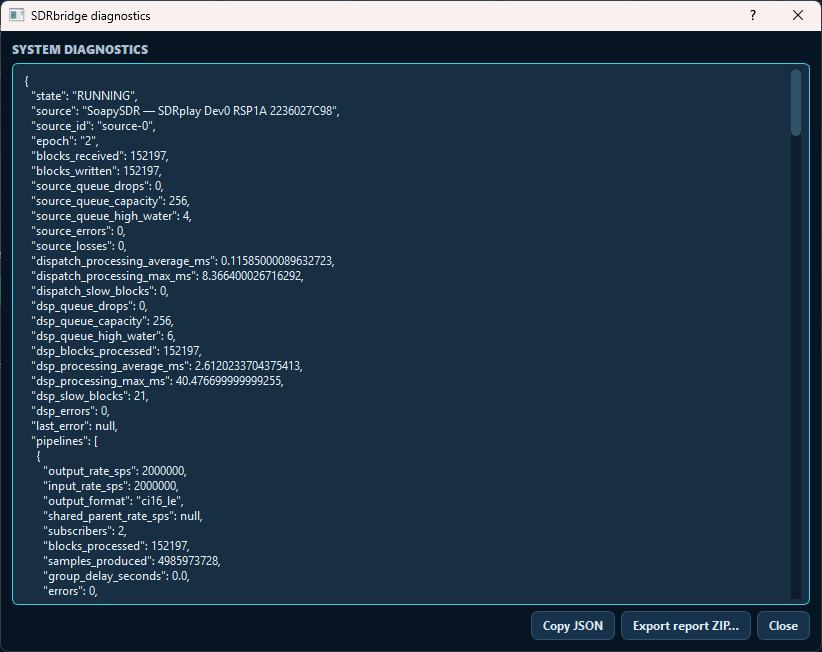
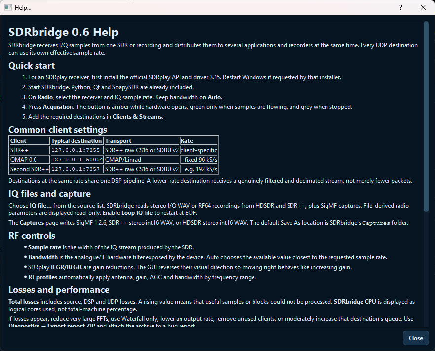
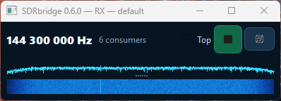

# Vue technique et preuves visuelles — SDRbridge 0.6.0

Cette page décrit la chaîne réellement exécutée sur Windows le 10 novembre
2026. Elle complète les tests automatisés par une preuve visuelle des clients,
des transports, des métriques et des principaux écrans opérateur.

## Chaîne multi-clients validée



La source est un SDRplay RSP1A à 144,300 MHz et 2 MS/s. SDRbridge est l’unique
propriétaire du matériel et distribue simultanément le même signal à :

- son analyseur RF interne, lecteur local du ring maître ;
- HDSDR 2.81a par `ExtIO_SDR_Bridge.dll` et le ring SDBR v2 ;
- SDRuno 1.42.1710 par la même DLL chargée dans `SDRuno.EXTIO.exe` ;
- SDR++ par SDBU v2 sur `127.0.0.1:7355` ;
- QMAP 0.6 par le transport Linrad à 96 kS/s sur `127.0.0.1:50004` ;
- une seconde destination SDBU v2 configurée sur `127.0.0.1:7356`.

La capture prouve visuellement la réception dans HDSDR, SDRuno, SDR++ et QMAP.
La ligne UDP `7356` est prouvée comme destination émise par SDRbridge, mais
l’image ne montre pas la fenêtre de son récepteur : une destination UDP sans
handshake peut être marquée *streaming* même si aucun client n’écoute.

```text
SDRplay RSP1A — CS16, 2 MS/s, 144,300 MHz
                    |
             ring maître SDBR v2
              /        |         \
       GUI spectrum   HDSDR     SDRuno
                    ExtIO local ExtIO local
                    |
             pipelines et sorties UDP
              /          |          \
       SDBU 7355     QMAP 50004    SDBU 7356
        2 MS/s         96 kS/s       2 MS/s
```

## Lecture des métriques



Les six consommateurs visibles sont le spectre GUI, deux lecteurs ExtIO et
trois destinations UDP. Les deux lignes locales affichent encore le nom
historique **HDSDR ExtIO** : la première correspond à HDSDR et la seconde à
SDRuno, car la même DLL s’enregistre actuellement sous un nom fixe. C’est une
limite d’affichage connue de la version 0.6, pas deux processus HDSDR.

À 2 MS/s en `CS16`, un flux représente `2 000 000 × 32 = 64 Mb/s` :

- UDP utile : `64 + 64 + (96 000 × 32) = 131,072 Mb/s`, affichés **131,1 Mb/s** ;
- lecteurs locaux : `3 × 64 = 192 Mb/s` pour le GUI, HDSDR et SDRuno ;
- débit IQ logique : `131,072 + 192 = 323,072 Mb/s`, affichés **323,1 Mb/s**.

Le **débit réseau mesuré** d’environ 130 Mb/s est calculé sur les octets UDP
réellement envoyés pendant l’intervalle de rafraîchissement. Les lecteurs
ExtIO ne l’augmentent pas : leur IQ passe par mémoire partagée.

Les lignes ExtIO peuvent rester à zéro dans **Packets / blocks**. La DLL lit le
ring directement mais ne renvoie pas encore sa progression au serveur ; le
statut *active*, la connexion locale et les spectres des applications sont les
preuves d’activité. De même, les blocs sautés du lecteur **GUI spectrum** sont
des images volontairement non rendues pour suivre le bloc le plus récent. Ils
ne constituent pas des pertes d’acquisition ou de sortie, ce qui explique
**Total losses = 0** malgré un compteur local de blocs ignorés.

Sur les différentes captures, SDRbridge utilise environ 0,38 à 1,02 cœur
logique sur les six disponibles. Le compteur global reste à zéro perte et la
barre d’état indique zéro drop de traitement et zéro erreur.

## Onglet Radio



La page Radio rassemble la source effective, le débit, la bande passante
matérielle, l’antenne, les réductions de gain SDRplay et l’AGC. La capture
montre le RSP1A `2236027C98`, 2 MS/s, une bande passante automatique de
1,536 MHz, IFGR 40 dB et RFGR état 0. Le VFO est à 144,300 MHz.

Le mode **Split** aligne spectre et waterfall sur le même axe de fréquences
absolues. Les deux curseurs verticaux règlent l’échelle d’affichage Max/Min ;
ils ne modifient pas les gains du récepteur.

## Onglet Profils RF



Les règles RF mémorisent par plage la priorité, l’antenne, l’AGC, les gains, la
bande passante et l’hystérésis. L’exemple contient une règle VHF 144–146 MHz
et une règle transverter 23 cm 1296–1298 MHz. **Manual override active** indique
que l’automatisme est temporairement suspendu ; **Resume AUTO** le réactive.

## Onglet Captures



La capture montre le profil maître `CS16`, le dossier proposé par défaut
`C:\Projets\SDRBridge\Captures` et le format SigMF 1.2.6. Le sélecteur permet
également les WAV IQ stéréo int16 compatibles SDR++ et HDSDR. Le bouton de
capture ouvre toujours une boîte **Enregistrer sous** avant l’écriture et ne
remplace jamais silencieusement un fichier existant.

## Diagnostics et aide intégrée



Les diagnostics exposent l’état RX, la source, les blocs, les profondeurs de
files, les temps de traitement, les erreurs et chaque pipeline DSP. **Export
report ZIP** produit l’archive à joindre à un rapport de bug.



L’aide embarquée couvre le démarrage, les transports clients, les fichiers IQ,
les captures, les réglages RF, les pertes et les prérequis. Elle existe en
français et en anglais et suit la langue sélectionnée dans les réglages.

## Vue compacte



La vue compacte conserve la fréquence centrale, le nombre de consommateurs,
le mode premier plan, la commande Play/Stop et les mini-vues spectre/waterfall.
Le bouton d’acquisition est vert uniquement lorsque les échantillons circulent.

## Périmètre de cette preuve

Cette recette certifie, sur la machine testée, la coexistence RX de HDSDR
2.81a, SDRuno 1.42.1710, SDR++ 1.3.2 et QMAP 0.6 avec SDRbridge 0.6.0. Elle ne
certifie pas encore les futurs adaptateurs SDR#, SDRangel, `rtl_tcp` ou Soapy,
prévus pour une version ultérieure. Elle ne remplace pas non plus le test
d’endurance longue ni la signature numérique de l’installeur final.
